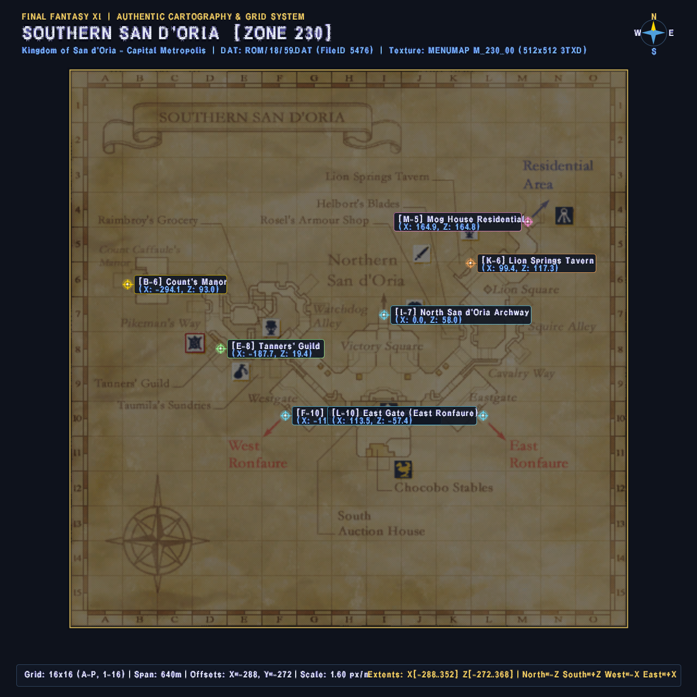
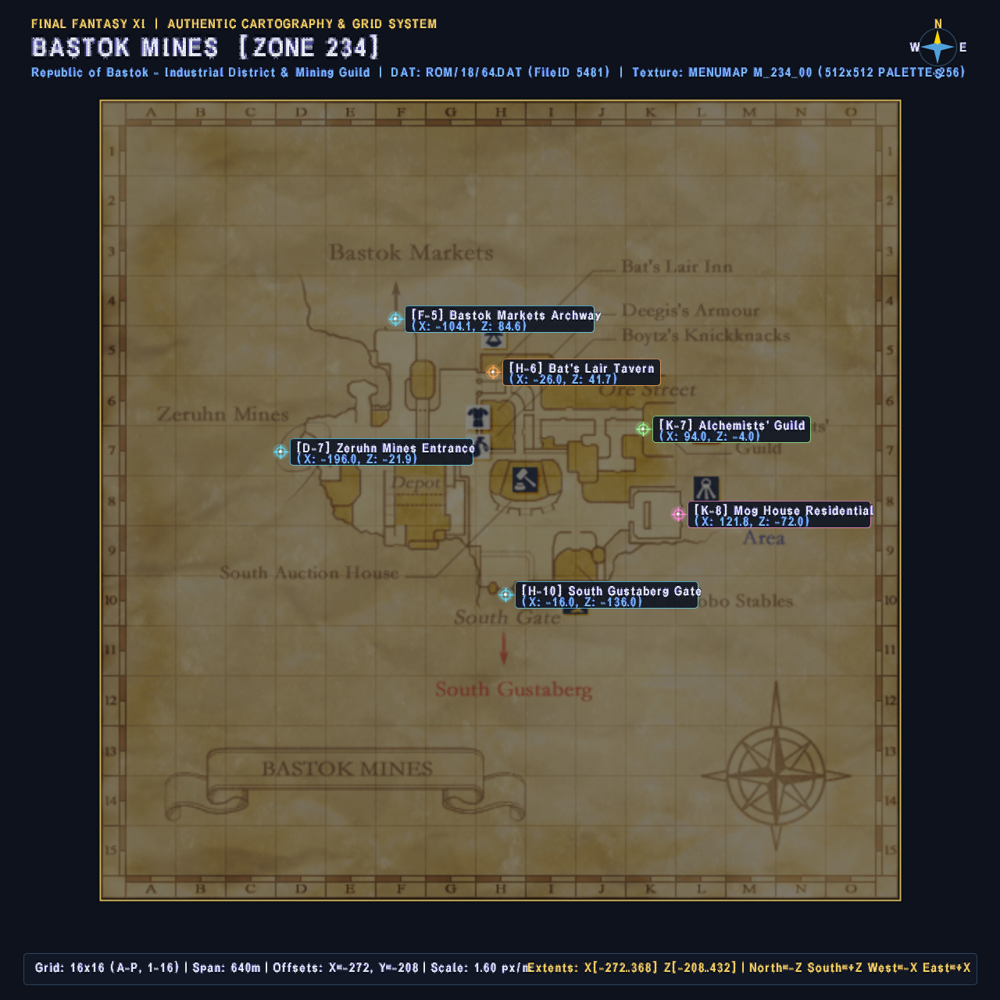
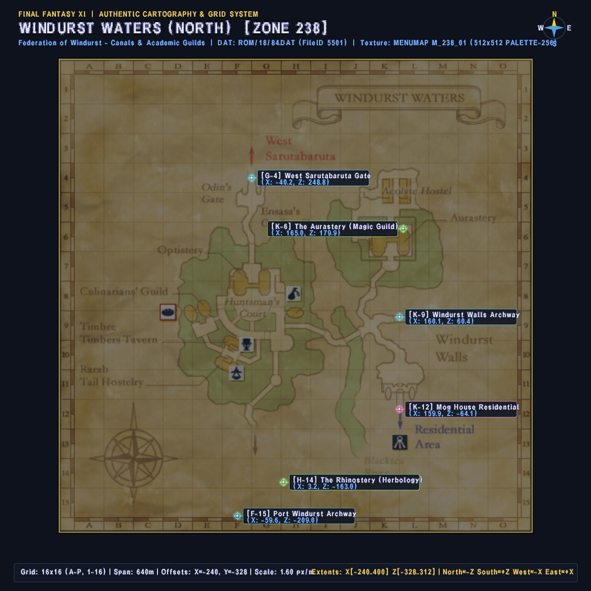
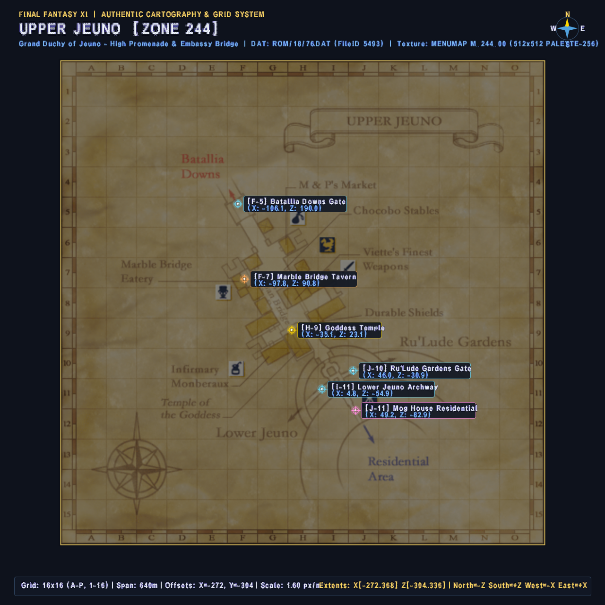

# Retail In-Game Zone Cartography & Technical Maps

This gallery documents the authentic in-game 2D maps decoded and rendered directly from retail Final Fantasy XI ROM DAT archives (`client-desktop` / `game-asset-pipeline`).

---

## Technical Overview & Cartographic Pipeline

1. **DAT Decoders & Texture Decompression**:
   - Extracted directly from client DAT structures (`MENUMAP` records).
   - Decodes both S3TC / DXT3 block-compressed textures and 8-bit paletted (256-color indexed) sub-layers.
   - Reconstructs authentic color ramps, texturing, parchment backgrounds, and compass roses.

2. **World-Space Coordinate Alignment**:
   - **North Vector**: $-Z$ (standard FFXI coordinate space).
   - **East Vector**: $+X$.
   - **Up Vector**: $+Y$.
   - World-space bounding extents ($[X_{\min}, X_{\max}] \times [Z_{\min}, Z_{\max}]$) and origin offsets are derived directly from zone DAT headers to map server entity coordinates $(X, Z)$ to map pixels $(u, v)$.

3. **Landmark Waypoints & POI Reticles**:
   - Zone lines, Mog Houses, Auction Houses, Consulates, airship ports, and residential areas are positioned at exact world coordinates.
   - In-game presentation maintains visual fidelity to the original client without artificial synthetic cartographic grid lines.

---

## Representative Major City Zones

### 1. Kingdom of San d'Oria — South San d'Oria (Zone 230)

- **DAT File**: `ROM/23/9.DAT` (Zone 230)
- **Key Points of Interest**:
  - West Ronfaure Gate & Watchtower
  - Place de Saint d'Oraguille / Auction House Courtyard
  - King Ranperre's Tomb Exit & East San d'Oria Archway
  - Mog House Residential District

---

### 2. Republic of Bastok — Bastok Mines (Zone 234)

- **DAT File**: `ROM/23/13.DAT` (Zone 234)
- **Key Points of Interest**:
  - Zeruhn Mines Entrance & Railway Terminal
  - Bastok Markets Tunnel & Commercial District
  - Residential Area & Chocobo Stables
  - Metalworks Skybridge Access

---

### 3. Federation of Windurst — Windurst Waters (Zone 238)

- **DAT File**: `ROM/23/17.DAT` (Zone 238)
- **Key Points of Interest**:
  - Aurastery Canal Bridge & Academy of Science
  - Windurst Walls & Windurst Woods Waterways
  - West Sarutabaruta Outpost Gate
  - North Canal Residential Quarter

---

### 4. Grand Duchy of Jeuno — Upper Jeuno (Zone 244)

- **DAT File**: `ROM/23/23.DAT` (Zone 244)
- **Key Points of Interest**:
  - Ru'Lude Gardens Grand Stairs & Archduke Palace Ascent
  - Lower Jeuno Walkway & Merchant Street Ramparts
  - Batallia Downs Gate & Defensive Bastion
  - Temple of the Goddess (Jeuno Cathedral)
