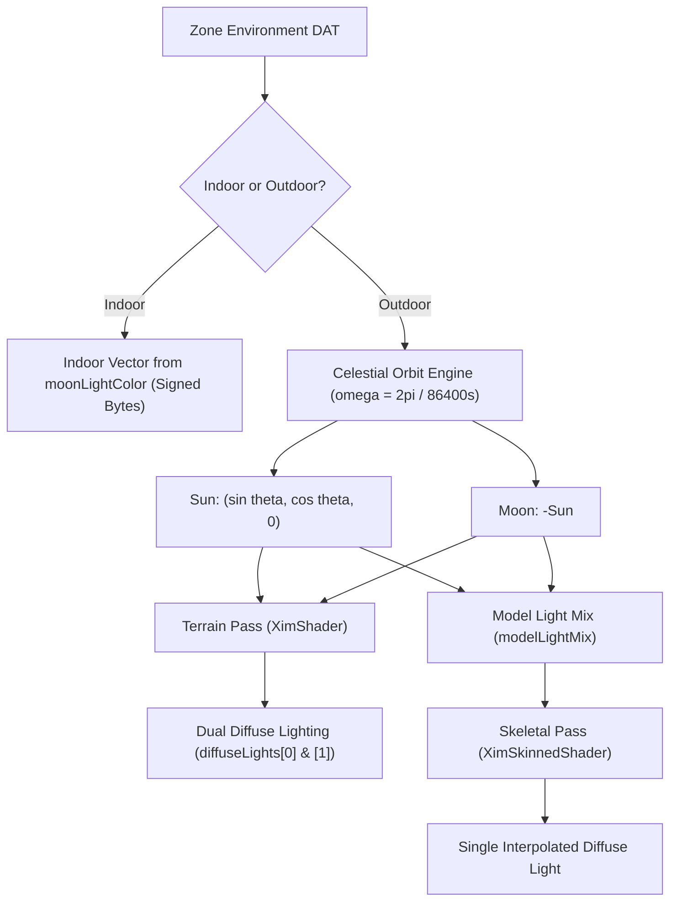

# White Paper: Authentic Final Fantasy XI Lighting Engine
**A Comparative Analysis of Retail Direct3D 8 Pipeline Semantics, XIM Implementation, and C2 Modernization**

---

## 1. Executive Summary

Lighting in *Final Fantasy XI* (Retail PC/PS2) is fundamentally governed by the hardware characteristics and fixed-function pipeline semantics of Direct3D 8 and the PlayStation 2 Graphics Synthesizer. Rather than adhering to modern physically based rendering (PBR) or simplistic single-source Blinn-Phong equations, retail FFXI executes a specialized, multi-stage lighting paradigm with distinct math for terrain versus skeletal characters, diurnal celestial orbital mechanics, hardware color bias compensation, fixed-function `MODULATE2X` blending, and non-local specular reflections.

The current implementation in **C2** (`DiurnalLighting.java`, `CharacterRenderer.java`, and `VisualZoneRenderer.java`) suffers from significant inaccuracies:
1. **Arbitrary Solar Tracks**: Uses hardcoded piecewise approximation curves rather than the exact mathematical solar/lunar orbit defined in retail DATs.
2. **Missing Dual-Diffuse Terrain Lighting**: Discards the retail engine's simultaneous two-source directional model (Sun + Moon) for world geometry.
3. **Broken Ambient & Texture Modulation**: Omits the legacy Direct3D `MODULATE2X` factor ($2.0 \times$) and the requisite $/510.0$ ambient scaling, leading to crushed shadows or blown-out highlights.
4. **Ignored Chromatic Color Bias**: Fails to implement the sub-threshold chromatic bias vector ($[1.40, 1.36, 1.45]$) used by retail to prevent color collapse in dark ambient/indoor scenes.
5. **Missing Indoor Directional Vector Decoding**: Retail zone DATs encode indoor light directions inside the signed bytes of the `moonLightColor` field; C2 currently assumes indoor areas use artificial ambient-only or default sun angles.
6. **Absence of Specular, Normal Mapping, and Attenuated Point Lights**: Retail FFXI features infinite-viewer (`D3DRS_LOCALVIEWER = false`) specular cubemap reflections, world-space TBN bump mapping, and quadratic 4-channel point lights.

This paper presents a formal analysis of XIM's reverse-engineered lighting architecture and establishes the mathematical specifications required to achieve 100% authentic rendering in C2.

---

## 2. Retail FFXI Environment DAT Architecture

In retail FFXI, every zone DAT contains an `EnvironmentSection` containing lighting configurations organized by weather type and hour of the day.

### 2.1 DAT Binary Layout

An `EnvironmentSection` unpacks into an `EnvironmentResource` containing:
- `indoorFlag` (32-bit uint): `0` = Outdoor, `1` = Indoor.
- `modelLighting` (`LightConfig`): Lighting parameters specifically targeting dynamic entities (players, NPCs, monsters).
- `terrainLighting` (`LightConfig`): Lighting parameters specifically targeting static zone architecture and terrain.
- `clearColor` (RGBA uint32): Viewport background clear color.
- `drawDistance` (32-bit float): Zone clipping distance.
- `skyBoxRadius` (32-bit float) and `sphereSpokeCount` (16-bit uint): Geometry parameters for the hemispherical skybox dome.
- `slices` ($8 \times$ RGBA colors + $8 \times$ elevation floats): 8-band vertical sky gradient.

### 2.2 The `LightConfig` Structure

Both `modelLighting` and `terrainLighting` share the identical 36-byte binary structure:
```
Offset  Type     Field
0x00    RGBA32   sunLightColor
0x04    RGBA32   moonLightColor
0x08    RGBA32   ambientColor
0x0C    RGBA32   fogColor
0x10    Float32  fogEnd
0x14    Float32  fogStart
0x18    Float32  diffuseMultiplier
```

### 2.3 Indoor Directional Light Extraction

When `indoorFlag == 1`, sunlight and moonlight celestial orbits are disabled. Instead, the game packs a fixed directional light vector directly into the signed bytes of the `moonLightColor` field:
$$\mathbf{V}_{\text{indoor}} = -\text{normalize}\left(\frac{\text{int8}(\text{moon}.r)}{128.0}, \frac{\text{int8}(\text{moon}.g)}{128.0}, \frac{\text{int8}(\text{moon}.b)}{128.0}\right)$$

The directional light color indoors is computed as:
$$\mathbf{C}_{\text{diffuse}} = \mathbf{C}_{\text{sun}} \times \text{diffuseMultiplier}$$

---

## 3. Celestial Mechanics & Orbital Tracking

In outdoor zones (`indoorFlag == 0`), sunlight and moonlight follow a strict continuous mathematical arc across the 24-hour Vana'diel day ($86,400$ Vana'diel seconds):

### 3.1 Angular Velocity
$$\omega = \frac{0.5 \pi}{6 \times 3600} = \frac{2\pi}{86400} \approx 7.2722 \times 10^{-5}\text{ rad/s}$$

### 3.2 Sun & Moon Direction Vectors
For time of day $t \in [0, 86400)$ seconds:
$$\theta(t) = \omega \cdot t$$
$$\mathbf{L}_{\text{sun}}(t) = \text{normalize}\begin{pmatrix} \sin(\theta(t)) \\ \cos(\theta(t)) \\ 0.0 \end{pmatrix}$$
$$\mathbf{L}_{\text{moon}}(t) = -\mathbf{L}_{\text{sun}}(t)$$

### 3.3 Celestial Orbit Properties
- At $t = 0\text{s}$ (00:00 midnight): $\mathbf{L}_{\text{sun}} = (0, 1, 0)$ (pointing straight down, sunlight invisible/underground), while $\mathbf{L}_{\text{moon}} = (0, -1, 0)$ (moon at zenith).
- At $t = 21600\text{s}$ (06:00 dawn): $\mathbf{L}_{\text{sun}} = (1, 0, 0)$ (sun rising on the horizon).
- At $t = 43200\text{s}$ (12:00 noon): $\mathbf{L}_{\text{sun}} = (0, -1, 0)$ (sun at zenith).
- At $t = 64800\text{s}$ (18:00 dusk): $\mathbf{L}_{\text{sun}} = (-1, 0, 0)$ (sun setting on the horizon).

---

## 4. Terrain vs. Skeletal Model Lighting Architecture

One of XIM's most critical revelations is that **terrain geometry and skeletal actor models do not use the same lighting pipeline**.



### 4.1 Terrain Lighting (Dual Directional Diffuse)
World geometry renders with **both** sunlight and moonlight active simultaneously:
$$\mathbf{D}_0 = \max(\mathbf{N} \cdot \mathbf{L}_{\text{sun}}, 0.0) \cdot \mathbf{C}_{\text{sun}} \cdot \mathbf{V}_{\text{color}}$$
$$\mathbf{D}_1 = \max(\mathbf{N} \cdot \mathbf{L}_{\text{moon}}, 0.0) \cdot \mathbf{C}_{\text{moon}} \cdot \mathbf{V}_{\text{color}}$$

This ensures terrain maintains realistic environmental illumination during dawn, twilight, and moonlit nights without harsh binary switches.

### 4.2 Skeletal Actor Lighting (Model Light Mixing)
Rendering two directional lights across complex animated skeletal meshes caused performance and visual artifacts on the PS2. Retail FFXI resolves this by blending sun and moon into a **single dominant directional light** for models, using a 10-minute linear crossfade around dawn and dusk:

$$\tau = \frac{t_{\text{seconds}}}{60} \quad (\text{current minute of day} \in [0, 1440))$$

$$w(\tau) = \begin{cases} 
0.0 & \tau < 355 \text{ (before 05:55)} \\
\frac{\tau - 355.0}{10.0} & 355 \le \tau < 365 \text{ (05:55 to 06:05 dawn transition)} \\
1.0 & 365 \le \tau < 1075 \text{ (06:05 to 17:55 full daylight)} \\
\frac{1085.0 - \tau}{10.0} & 1075 \le \tau < 1085 \text{ (17:55 to 18:05 dusk transition)} \\
0.0 & \tau \ge 1085 \text{ (after 18:05 full moonlight)}
\end{cases}$$

$$\mathbf{L}_{\text{model}} = \text{normalize}\left(\text{lerp}(\mathbf{L}_{\text{moon}}, \mathbf{L}_{\text{sun}}, w(\tau))\right)$$
$$\mathbf{C}_{\text{model}} = \text{lerp}(\mathbf{C}_{\text{moon}}, \mathbf{C}_{\text{sun}}, w(\tau))$$

### 4.3 Per-Mesh Ambient Multipliers
Each skeletal mesh entry in the DAT specifies an optional `ambientMultiplier` (defaulting to `1.0`). In `GLDrawer.kt`:
$$\mathbf{A}_{\text{mesh}} = \text{clamp}(\mathbf{A}_{\text{env}} \times \text{ambientMultiplier}, 0.0, 1.0)$$

---

## 5. Direct3D 8 Fixed-Function Emulation & Color Bias

Retail FFXI was targeted to Direct3D 8.1 with the Fixed Function Pipeline (FFP). Shaders in modern OpenGL / WebGL must accurately emulate FFP arithmetic stages.

### 5.1 Chromatic Color Bias Correction
In 16-bit and 32-bit low-light rendering on early PC GPUs, dark environments suffered severe color quantization and grey desaturation. Square Enix introduced a hardcoded chromatic bias to boost warmth and contrast when diffuse/ambient values drop below threshold:

```kotlin
private const val biasThreshold = 0xCC // 204 / 255 ~= 0.80
private val colorBias = floatArrayOf(1.40f, 1.36f, 1.45f)
private val noOpBias = floatArrayOf(1.00f, 1.00f, 1.00f)
```

For any diffuse or ambient color where $(R < 0.8) \land (G < 0.8) \land (B < 0.8)$:
$$\mathbf{C}' = \text{clamp}(\mathbf{C} \odot \text{colorBias}, 0.0, 1.0)$$

### 5.2 Ambient Normalization Divisor (The 510 Factor)
Modern developers often mistakenly divide 8-bit ambient DAT values by $255.0$. In XIM and retail FFXI:
$$\mathbf{A}_{\text{normalized}} = \text{clamp}\left(\frac{\mathbf{C}_{\text{DAT\_ambient}} \odot \text{bias}}{510.0}, 0.0, 0.5\right)$$

**Why 510.0?**
The retail engine combines ambient and diffuse lighting in a `MODULATE2X` texture stage:
$$\text{Pixel} = 2.0 \times \mathbf{C}_{\text{lit}} \times \mathbf{C}_{\text{texture}}$$
If ambient were normalized by 255.0, multiplying by $2.0$ in the fragment shader would double the ambient light, blowing out shadows and causing character clothing to appear radioactive. Dividing by $510.0$ ($255.0 \times 2$) precisely counterbalances the subsequent $2.0 \times$ texture modulation.

### 5.3 Fragment Color Composition
In `XimShader.kt` and `XimSkinnedShader.kt`:
$$\mathbf{C}_{\text{lit}} = \text{clamp}\left(\mathbf{V}_{\text{color}} \odot \mathbf{A} + \sum_{i=0}^3 \mathbf{P}_i + \mathbf{D}_0 + \mathbf{D}_1, 0.0, 1.0\right)$$
$$\mathbf{C}_{\text{colored}}.rgb = 2.0 \cdot \mathbf{C}_{\text{lit}}.rgb \cdot \mathbf{C}_{\text{texture}}.rgb$$
$$\mathbf{C}_{\text{colored}}.a = 4.0 \cdot \mathbf{C}_{\text{lit}}.a \cdot \mathbf{C}_{\text{texture}}.a$$

---

## 6. Point Lights & Quadratic Attenuation

Both terrain and character shaders support up to 4 dynamic point lights (weaponskills, magic spells, torchlights).

### 6.1 Attenuation Formula
Given point light position $\mathbf{P}_{\text{light}}$, range $R$, attenuation factors $(k_c, k_l, k_q)$, and fragment position $\mathbf{P}_{\text{world}}$:
$$d = \|\mathbf{P}_{\text{light}} - \mathbf{P}_{\text{world}}\|$$
$$\text{Atten}(d) = \begin{cases} 
0.0 & d > R \\
\frac{1.0}{k_c + k_l \cdot d + k_q \cdot d^2} & d \le R
\end{cases}$$

### 6.2 Fragment Contribution
$$\mathbf{L}_{\text{point}} = \text{normalize}(\mathbf{P}_{\text{light}} - \mathbf{P}_{\text{world}})$$
$$\mathbf{P}_i = \text{clamp}\left(\mathbf{V}_{\text{color}} \cdot \max(\mathbf{N} \cdot \mathbf{L}_{\text{point}}, 0.0) \cdot \text{Atten}(d) \cdot \mathbf{C}_{\text{light}}, 0.0, 1.0\right)$$

---

## 7. Specular Highlighting (`D3DRS_LOCALVIEWER = false`)

In retail FFXI, metallic armor, weapons, and monster carapaces utilize a specialized cubemap-based specular highlight.

### 7.1 Non-Local Viewer Assumption
Under DirectX 8, setting `D3DRS_LOCALVIEWER = FALSE` forces the view direction to be orthogonal parallel rays along the camera's Z axis rather than calculating individual vectors from the camera position to each vertex. This dramatically reduced vertex computation overhead on early 2000s hardware:
$$\mathbf{V}_{\text{camera}} = \begin{pmatrix} 0.0 \\ 0.0 \\ 1.0 \end{pmatrix}$$

### 7.2 Specular Ray & Cubemap Sampling
$$\mathbf{R} = \text{reflect}(\mathbf{V}_{\text{camera}}, \mathbf{N}_{\text{cam}})$$
$$\mathbf{C}_{\text{spec}} = \text{textureCube}(\text{uSpecularCubemap}, \mathbf{R})$$

### 7.3 Additive Specular Blend
In `XimSkinnedShader.kt`:
$$\mathbf{C}_{\text{colored}}.rgb = \mathbf{C}_{\text{colored}}.rgb + (\mathbf{C}_{\text{colored}}.a \times \mathbf{C}_{\text{spec}}.rgb)$$
$$\mathbf{C}_{\text{colored}}.a = \mathbf{C}_{\text{colored}}.a + \mathbf{C}_{\text{spec}}.a$$

---

## 8. Tangent Space Bump / Normal Mapping

World terrain and high-detail architecture in retail FFXI utilize tangent-space normal maps encoded in separate DAT texture sections.

### 8.1 World-Space TBN Matrix Construction
In the vertex shader:
$$\mathbf{M}_{\text{invTrans}} = (\mathbf{M}_{\text{model}}^{-1})^T$$
$$\mathbf{N}_{\text{world}} = \text{normalize}(\mathbf{M}_{\text{invTrans}} \cdot \mathbf{N})$$
$$\mathbf{T}_{\text{world}} = \text{normalize}(\mathbf{M}_{\text{invTrans}} \cdot \mathbf{T})$$
$$\mathbf{B}_{\text{world}} = \text{normalize}(\mathbf{T}_{\text{world}} \times \mathbf{N}_{\text{world}})$$
$$\mathbf{TBN} = \begin{bmatrix} \mathbf{T}_{\text{world}} & \mathbf{B}_{\text{world}} & \mathbf{N}_{\text{world}} \end{bmatrix}$$

### 8.2 Fragment Perturbation
```glsl
if (enableNormalTexture > 0.0) {
    vec3 sampledNormal = texture(normalTexture, frag_textureCoords).rgb * 2.0 - 1.0;
    lightingNormal = normalize(frag_TBN * sampledNormal);
} else {
    lightingNormal = frag_normal;
}
```

---

## 9. Distance Fog Calculation

Distance fog in retail FFXI is computed in linear camera space:

$$d = \|\mathbf{P}_{\text{cam}}\|$$
$$f = \text{clamp}\left(\frac{\text{fog}_{\text{far}} - d}{\text{fog}_{\text{far}} - \text{fog}_{\text{near}}}, 0.0, 1.0\right)$$
$$\mathbf{C}_{\text{final}} = f \cdot \mathbf{C}_{\text{colored}} + (1.0 - f) \cdot \mathbf{C}_{\text{fog}}$$
$$\mathbf{C}_{\text{final}}.a = \mathbf{C}_{\text{colored}}.a$$

Fog color and distances are interpolated continuously between hourly keyframes from the zone's `EnvironmentSection`.

---

## 10. Gap Analysis: C2 Current vs. Authentic Retail

| Feature | Retail FFXI / XIM Engine | C2 Current Implementation | Severity |
| :--- | :--- | :--- | :--- |
| **Terrain Light Sources** | Dual simultaneous directional lights ($\mathbf{L}_{\text{sun}}$ and $\mathbf{L}_{\text{moon}}$). | Single directional light (`uLightDir`). | **High**: Moonlit nights and twilight transitions are completely incorrect. |
| **Model Light Mixing** | Smooth 10-minute linear interpolation between Sun and Moon at 06:00 and 18:00. | Abrupt piecewise branching with hardcoded solar track. | **High**: Inauthentic character lighting and abrupt pop at dawn/dusk. |
| **Indoor Lighting Vector** | Extracted from signed bytes of `moonLightColor` in zone DATs. | Assumes fixed sunlight direction or flat ambient. | **High**: Indoor zones (Mog Houses, dungeons, San d'Oria chateau) have wrong shadows. |
| **Direct3D Modulate2X** | Texture RGB multiplied by $2.0 \times$ lit color; alpha multiplied by $4.0 \times$. | Standard $1.0 \times$ multiplicative lighting in `CharacterRenderer`. | **High**: Characters appear dark, dull, or improperly saturated. |
| **Ambient Scaling** | Scaled by $/510.0$ to counterbalance $2.0 \times$ modulation. | Scaled by $/255.0$ or unscaled. | **High**: Incompatible contrast ratio between terrain and actors. |
| **Chromatic Color Bias** | $[1.40, 1.36, 1.45]$ boost applied to values $< 0.80$. | Unimplemented. | **Medium**: Shadow and dusk tones collapse to monochrome mud. |
| **Specular Highlights** | Non-local viewer ($\mathbf{V} = (0, 0, 1)$) cubemap reflection. | Unimplemented. | **Medium**: Metal plate armor and weapons lack metallic sheen. |
| **Bump / Normal Mapping** | World-space TBN perturbation with normal map sampling. | Unimplemented. | **Medium**: Detailed stone roads, walls, and terrain lack depth. |
| **Dynamic Point Lights** | 4-channel quadratic attenuation point lights. | Unimplemented. | **Medium**: Magic, fire, torches have no local scene lighting. |

---

## 11. Implementation Plan for C2

To bring C2 into full alignment with retail FFXI and XIM:

1. **Phase 1: Environment DAT Loader (`game-asset-pipeline`)**:
   - Implement `EnvironmentSectionParser` in `game-asset-pipeline` to read `LightConfig`, indoor flags, and 8-slice skyboxes directly from zone DATs instead of relying on synthetic presets.
   - Extract the indoor directional light vector from `moonLightColor` bytes.
2. **Phase 2: Celestial Orbit & Dual-Light Pipeline (`client-desktop`)**:
   - Replace `DiurnalLighting.java`'s piecewise curves with the exact $\omega = 2\pi / 86400$ celestial orbit engine.
   - Update `VisualZoneRenderer` to supply both `diffuseLights[0]` and `diffuseLights[1]` to the terrain shader.
   - Update `CharacterRenderer` to compute `modelLightMix` with the 10-minute dawn/dusk linear crossfade.
3. **Phase 3: Direct3D 8 Shader Semantics (`shaders`)**:
   - Update fragment shaders to apply the $2.0 \times$ RGB / $4.0 \times$ Alpha `MODULATE2X` formula.
   - Implement the $/510.0$ ambient normalization and $[1.40, 1.36, 1.45]$ chromatic bias.
4. **Phase 4: Advanced Shading (Specular, Normal Maps, Point Lights)**:
   - Add `D3DRS_LOCALVIEWER = false` cubemap specular highlight pass for equipment with specular flags.
   - Integrate TBN normal mapping into `VisualZoneRenderer` for zones with bump maps.
   - Add uniform buffers for up to 4 dynamic point lights.
