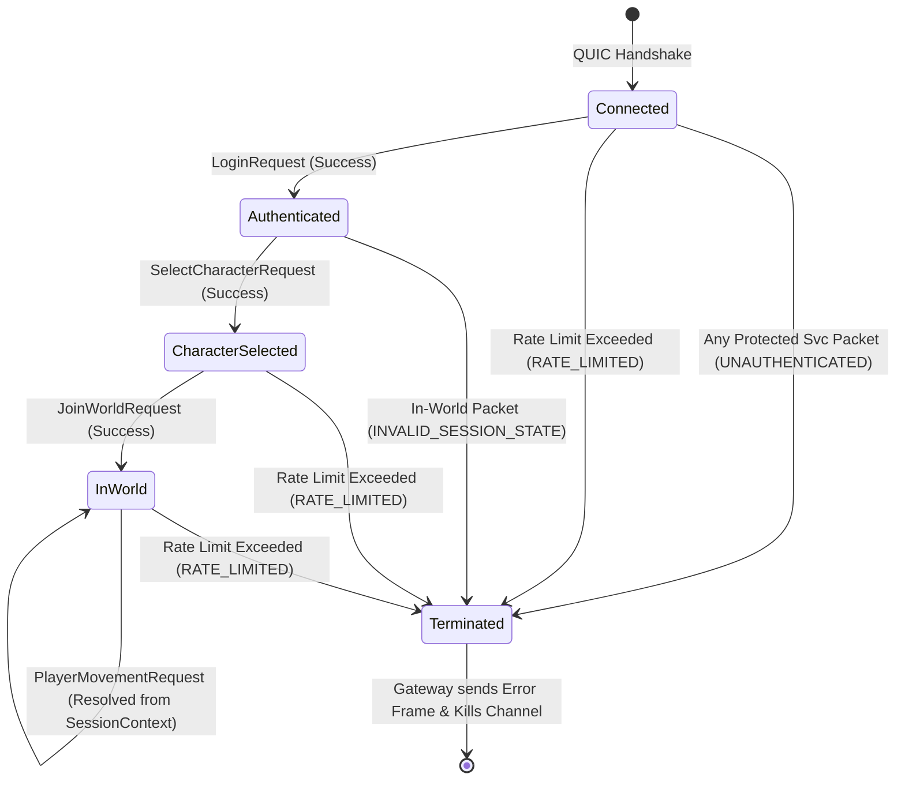

# Data Model: Protocol Synchronization, Session Identity Integrity, and Gateway Error Feedback

## Entities & Schemas

### 1. GatewayErrorResponse
The standardized protocol message emitted by the Edge Gateway when a client request cannot be dispatched or violates protocol policies.

- **Package**: `com.example.common.dto`
- **Service ID**: `ServiceType.SYSTEM` (1)
- **Message ID**: `MessageType.GATEWAY_ERROR_RESPONSE` (52)
- **Wire Registration ID**: `52`
- **Fields**:
  | Field | Type | Description |
  | :--- | :--- | :--- |
  | `errorCode` | `short` | Categorized error identifier (see Error Codes table) |
  | `rejectedServiceId` | `short` | The service identifier of the packet that triggered the error |
  | `rejectedMessageId` | `short` | The message identifier of the packet that triggered the error |
  | `message` | `String` | Human-readable explanation of the rejection |

#### Error Codes Catalog
| Code | Name | Action Policy | Description |
| :---: | :--- | :--- | :--- |
| `1001` | `UNAUTHENTICATED` | **Sever Connection** | Client attempted to access protected service without valid auth |
| `1002` | `RATE_LIMITED` | **Sever Connection** | Token bucket capacity exhausted; flood prevention triggered |
| `1003` | `INVALID_SESSION_STATE` | **Sever Connection** | Out-of-state packet (e.g. in-world action before character selection) |
| `1004` | `MALFORMED_PAYLOAD` | **Sever Connection** | Packet framing corrupted or unregistered wire ID |
| `2001` | `SERVICE_UNAVAILABLE` | **Preserve Connection** | Destination backend service/zone pod is offline or unreachable |

---

### 2. JoinWorldRequest (Refactored)
Refactored to eliminate client-asserted actor character ID. Actor identity is derived strictly from the gateway session context.

- **Package**: `com.example.world.dto`
- **Service ID**: `ServiceType.WORLD` (3)
- **Message ID**: `MessageType.JOIN_WORLD_REQUEST` (300)
- **Wire Registration ID**: `300`
- **Fields**:
  | Field | Type | Description |
  | :--- | :--- | :--- |
  | `authToken` | `String` | Session authentication token for validation |

*(Note: `characterId` is removed from this client request DTO; the backend handler resolves character context strictly via `SessionContext.CHARACTER_ID` populated during lobby character selection).*

---

### 3. SessionContext (Authoritative Session State)
Maintained within the Edge Gateway and passed to backend handlers via `BackendEnvelope`.

- **Attributes**:
  | Attribute | Key | Type | Authority | Description |
  | :--- | :--- | :--- | :--- | :--- |
  | `SESSION_ID` | `SessionContext.SESSION_ID` | `Long` | Gateway | Unique connection session ID |
  | `ACCOUNT_ID` | `SessionContext.ACCOUNT_ID` | `Long` | Login Token | Authenticated account identity |
  | `CHARACTER_ID` | `SessionContext.CHARACTER_ID` | `Long` | Lobby Select | Authoritatively selected active character ID |
  | `ZONE_ID` | `SessionContext.ZONE_ID` | `Integer` | World / Zone | Currently bound zone identifier |
  | `WORLD_ID` | `SessionContext.WORLD_ID` | `Integer` | Lobby / World | Currently bound world identifier |

---

### 4. Wire Message Registry Schema
Authoritative catalog mapping message contracts to unique wire IDs.

- **Registry Root**: `ForySerializationProvider` in `common-protocol`.
- **Validation Rule**: Every DTO implementing `PacketMessage` must map to a unique numeric ID in the designated service range:
  - `1–49`: Gateway internal control plane (backend only, 32+ IDs reserved for backends/routing)
  - `50–99`: System diagnostics & health (Ping = 50, Pong = 51, GatewayErrorResponse = 52, SessionDisconnected = 99)
  - `100–199`: Authentication service
  - `200–299`: Lobby service
  - `300–399`: World service
  - `400–499`: Zone service

## State Transitions & Enforcement Matrix

