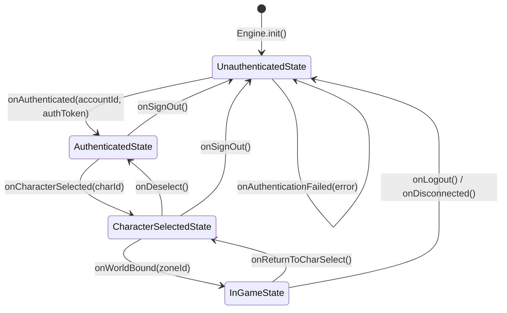

# Data Model: Desktop Client Baseline & Character Creation Pipeline

**Feature**: `002-desktop-client`  
**Date**: 2026-09-06

---

## 1. Entities & Data Structures

### 1.1 `AccountCredentials`
Client-side value object representing the credentials entered in `LoginPanel`.
- `username`: `String` (3..64 characters, trimmed)
- `password`: `String` (3..64 characters)

### 1.2 `CharacterSummary`
Lightweight summary record of an existing character retrieved from `lobby` service via `CharacterListResponse`. Matches `com.example.lobby.dto.CharacterSummary`:
- `characterId`: `long` (unique character identifier)
- `name`: `String` (1..16 characters, capitalized)
- `worldId`: `int` (shard/world server identity)
- `raceId`: `short` (canonical race model identifier; separate explicit field)
- `gender`: `short` (0=Male, 1=Female; separate explicit field)
- `zoneId`: `int` (current location zone ID)
- `level`: `int` (primary job level, 1..99)
- `nationId`: `short` (0=San d'Oria, 1=Bastok, 2=Windurst)
- `mainJobId`: `short` (1..22, see `JobId`)
- `subJobId`: `short` (0=None, 1..22)

### 1.3 `CreateCharacterRequest`
Payload constructed by `CharacterPanel` and dispatched via `QuicClient`. Matches `com.example.lobby.dto.CreateCharacterRequest`:
- `authToken`: `String` (session token obtained from `LoginResponse`)
- `worldId`: `int` (target world ID, defaults to current world)
- `name`: `String` (3..16 characters, letters only)
- `raceId`: `short` (canonical race identifier; separate explicit field)
- `gender`: `short` (0=Male, 1=Female; separate explicit field, never collapsed into race)
- `faceId`: `short` (0..15: calculated from base face 1..8 and variant B toggle)
- `hairId`: `short` (hair variation index, defaults to 0 or hair variant flag)
- `sizeId`: `short` (0..2: 0=Small, 1=Medium, 2=Large; constrained by race)
- `nationId`: `short` (0=San d'Oria, 1=Bastok, 2=Windurst)
- `mainJobId`: `short` (1..6 starting jobs)

### 1.4 `ClientState` (Observable State Store)
Singleton state holder observing network events and binding to ImGui render loops.
- `phase`: `AppPhase` (`DISCONNECTED`, `AUTHENTICATING`, `LOBBY_CHAR_SELECT`, `IN_WORLD`)
- `accountId`: `Long` (null when unauthenticated)
- `authToken`: `String` (active session token received from `LoginResponse`)
- `selectedCharacterId`: `Long` (null when no character chosen)
- `currentZoneId`: `Integer` (null when not in world)
- `lastErrorMessage`: `String` (cleared on subsequent successful actions)
- `characterList`: `List<CharacterSummary>` (thread-safe, updated on lobby responses)

### 1.5 `KeepaliveTelemetry`
Telemetry tracking heartbeat health in `InGamePanel`.
- `status`: `String` ("connected", "ok", "error", "idle")
- `lastRttMs`: `long` (round-trip latency in milliseconds, -1 when pending)
- `lastOkAt`: `Instant` (timestamp of last successful heartbeat acknowledgment)

---

## 2. Domain Enumerations

### 2.1 `RaceId`
Matches canonical Final Fantasy XI race IDs:

| ID | Constant          | Label           | Size Restriction     |
|:---|:------------------|:----------------|:---------------------|
| 1  | `HUME_MALE`       | Hume Male       | Selectable (0, 1, 2) |
| 2  | `HUME_FEMALE`     | Hume Female     | Selectable (0, 1, 2) |
| 3  | `ELVAAN_MALE`     | Elvaan Male     | Selectable (0, 1, 2) |
| 4  | `ELVAAN_FEMALE`   | Elvaan Female   | Selectable (0, 1, 2) |
| 5  | `TARUTARU_MALE`   | Tarutaru Male   | Forced Small (`0`)   |
| 6  | `TARUTARU_FEMALE` | Tarutaru Female | Forced Small (`0`)   |
| 7  | `MITHRA`          | Mithra          | Selectable (0, 1, 2) |
| 8  | `GALKA`           | Galka           | Forced Large (`2`)   |

### 2.2 `JobId`
Starting jobs available during creation (with constants for full 22 jobs from schema):

| ID     | Constant      | Title      | Category             |
|:-------|:--------------|:-----------|:---------------------|
| 1      | `WAR`         | Warrior    | Starting Job         |
| 2      | `MNK`         | Monk       | Starting Job         |
| 3      | `WHM`         | White Mage | Starting Job         |
| 4      | `BLM`         | Black Mage | Starting Job         |
| 5      | `RDM`         | Red Mage   | Starting Job         |
| 6      | `THF`         | Thief      | Starting Job         |
| 7..22  | `PLD`..`RUN`  | Advanced   | Unlockable (in-game) |

### 2.3 `NationId`
Starting allegiance nations:

| ID | Constant     | Name                   |
|:---|:-------------|:-----------------------|
| 0  | `SAND_ORIA`  | Kingdom of San d'Oria  |
| 1  | `BASTOK`     | Republic of Bastok     |
| 2  | `WINDURST`   | Federation of Windurst |

---

## 3. Validation Rules

1. **Character Name**:
   - Length: Minimum 3 characters, maximum 16 characters.
   - Character set: `[A-Za-z]` only (no spaces, numbers, or special symbols).
2. **Size Enforcement**:
   - `FORCED_SIZE = [-1, -1, -1, -1, 0, 0, -1, 2]`
   - If `FORCED_SIZE[raceId - 1] >= 0`, `sizeId` is unconditionally locked to that value.
   - Otherwise, `sizeId` must be in `{0, 1, 2}`.
3. **Face Index Encoding**:
   - `baseFace` $\in [1, 8]$
   - `variantB` $\in \{\text{false}, \text{true}\}$
   - `faceId = (clamp(baseFace, 1, 8) - 1) + (variantB ? 8 : 0)` (producing values `0..15`).
4. **Race and Gender Separation**:
   - `raceId` (short) and `gender` (short: 0=Male, 1=Female) are transmitted, processed, and stored as distinct, independent attributes.
   - When using `CharacterPanel`, selecting a character archetype sets both `raceId` and `gender` explicitly into their respective fields on `CreateCharacterRequest`. They are never collapsed or serialized into a single inferred field on the wire or in database persistence.

---

## 4. State Machine Progression

