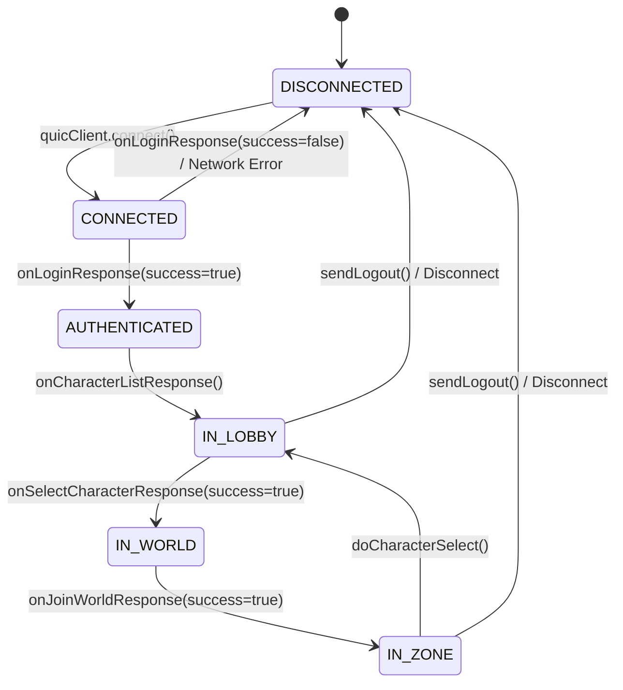

# Data Model: Canonical ClientState Unification & World Visualization

**Feature Branch**: `003-client-state-world-visualization`  
**Date**: 2026-09-07  
**Status**: Completed  

## 1. Overview

This document specifies the authoritative in-memory data models, entities, spatial representations, and state lifecycle transitions for Feature 003. All state is consolidated within `client-sdk` as the single canonical source of truth, observed reactively by the `client-desktop` presentation layer.

---

## 2. Core Entities & Models

### 2.1 Canonical `ClientState` (`com.example.client.state.ClientState`)

The authoritative singleton managing connection lifecycle, authenticated player credentials, account character roster, zone coordinates, latency telemetry, and remote player characters within the Area of Interest (AoI).

```text
┌─────────────────────────────────────────────────────────────────────────────┐
│                             com.example.client.state.ClientState            │
├─────────────────────────────────────────────────────────────────────────────┤
│ - connectionState: ClientConnectionState                                    │
│ - accountId: long                                                           │
│ - authToken: String                                                         │
│ - selectedCharacterId: Long                                                 │
│ - lastErrorCode: short                                                      │
│ - lastErrorMessage: String                                                  │
│ - currentWorldId: int                                                       │
│ - currentZoneId: int                                                        │
│ - x: float, y: float, z: float                                              │
│ - yaw: float, pitch: float                                                  │
│ - lastServerTick: long                                                      │
│ - currentLatencyMs: long                                                    │
│ - characters: List<CharacterSummary>                                        │
│ - remoteEntities: Map<Long, RemoteEntityState>                              │
│ - stateListeners: List<Consumer<ClientState>>                               │
├─────────────────────────────────────────────────────────────────────────────┤
│ + addOrUpdateRemoteEntity(spawn: EntitySpawnRecord): void                   │
│ + updateRemoteEntityMovement(update: EntityMovementUpdate): void            │
│ + removeRemoteEntity(characterId: long): void                               │
│ + updatePosition(x: float, y: float, z: float, yaw: float, tick: long): void│
│ + updateCharacters(characters: List<CharacterSummary>): void                │
│ + updateLatency(latencyMs: long): void                                      │
│ + onStateChange(listener: Consumer<ClientState>): void                      │
│ + notifyListeners(): void                                                   │
│ + reset(): void                                                             │
└─────────────────────────────────────────────────────────────────────────────┘
```

#### Field Specifications:

| Field | Type | Concurrency / Access | Description |
|---|---|---|---|
| `connectionState` | `ClientConnectionState` | `volatile` | Current protocol/session phase (`DISCONNECTED` to `IN_ZONE`). |
| `accountId` | `long` | `volatile` | Authenticated account identifier (0 if unauthenticated). |
| `authToken` | `String` | `volatile` | RSA-signed JWT bearer token used for authenticated requests. |
| `selectedCharacterId`| `Long` | `volatile` | Character ID chosen from roster for world entry (`null` if none). |
| `lastErrorCode` | `short` | `volatile` | Gateway error code from latest `GatewayErrorResponse`. |
| `lastErrorMessage` | `String` | `volatile` | Descriptive error message from server or connection failure. |
| `currentWorldId` | `int` | `volatile` | Target world server ID (default: 1). |
| `currentZoneId` | `int` | `volatile` | Active zone instance ID (e.g., 230 for S. San d'Oria). |
| `x`, `y`, `z` | `float` | `volatile` | Local player world coordinates (FFXI Cartesian coordinates). |
| `yaw`, `pitch` | `float` | `volatile` | Local player orientation (heading yaw in radians/degrees). |
| `lastServerTick` | `long` | `volatile` | Most recent server simulation tick acknowledged. |
| `currentLatencyMs` | `long` | `volatile` | Round-trip time (RTT) measured via ping/pong heartbeats. |
| `characters` | `List<CharacterSummary>`| `CopyOnWriteArrayList` | Roster of characters belonging to authenticated account. |
| `remoteEntities` | `Map<Long, RemoteEntityState>` | `ConcurrentHashMap` | Remote player characters currently tracked within AoI. |
| `stateListeners` | `List<Consumer<ClientState>>` | `CopyOnWriteArrayList` | Reactive listener callbacks invoked upon state mutations. |

---

### 2.2 Remote Player Character (`ClientState.RemoteEntityState`)

Immutable record representing an active remote player character within the local player's Area of Interest.

```java
public record RemoteEntityState(
    long characterId,
    String name,
    short mainJobId,
    short subJobId,
    int level,
    float x, float y, float z,
    float vx, float vy, float vz,
    float yaw, float pitch,
    int moveFlags
) {}
```

#### Invariants & Constraints:
- `characterId`: Must match the unique positive character ID registered on the backend.
- `name`: Non-null display name (e.g., "ElvaanKnight").
- `mainJobId`: FFXI Job identifier (1 = WAR, 2 = MNK, 3 = WHM, 4 = BLM, 5 = RDM, 6 = THF, etc.).
- `x`, `y`, `z`: World coordinates within AoI cell bounds.
- `vx`, `vy`, `vz`: Current velocity vector for client-side dead reckoning interpolation between server ticks.
- `yaw`: Remote player facing heading angle.

---

### 2.3 Presentation Radar Viewport Config (`RadarViewportConfig`)

Model defining user-configurable and reactive visual parameters for `WorldRadarPanel`:

```java
public class RadarViewportConfig {
    private float radarRadiusMeters = 50.0f; // Options: 25m, 50m, 100m, 200m
    private boolean showGrid = true;
    private boolean showAoiCircle = true;
    private boolean showNameplates = true;
    private boolean showCoordinates = true;
    private float aoiRadiusMeters = 50.0f;
}
```

---

### 2.4 Movement Intent (`MovementInputState`)

Frame-by-frame input accumulator capturing user input on the client thread before throttled packet dispatch:

```java
public class MovementInputState {
    private boolean moveForward;
    private boolean moveBackward;
    private boolean turnLeft;
    private boolean turnRight;
    private boolean strafeLeft;
    private boolean strafeRight;
    private long lastPacketTimeMs = 0L;
    private long clientTickCounter = 0L;

    public int computeMoveFlags() {
        int flags = MovementFlags.IDLE;
        if (moveForward) flags |= MovementFlags.FORWARD;
        if (moveBackward) flags |= MovementFlags.BACKWARD;
        if (strafeLeft) flags |= MovementFlags.STRAFE_LEFT;
        if (strafeRight) flags |= MovementFlags.STRAFE_RIGHT;
        if (turnLeft) flags |= MovementFlags.TURN_LEFT;
        if (turnRight) flags |= MovementFlags.TURN_RIGHT;
        return flags;
    }
}
```

---

## 3. State Lifecycle & Transitions

### 3.1 Client Connection & Application Lifecycle



### 3.2 State Reset Semantics

When `clientState.reset()` is invoked (upon user logout, network disconnect, or session termination):
1. `connectionState` is set to `DISCONNECTED`.
2. `accountId`, `authToken`, `selectedCharacterId` are cleared.
3. `currentZoneId` and `currentWorldId` are reset to default (0).
4. `x`, `y`, `z`, `yaw`, `pitch` are reset to `0.0f`.
5. `characters.clear()` flushes the account character roster.
6. `remoteEntities.clear()` purges all tracked player characters immediately.
7. `notifyListeners()` informs all UI panels to purge cached views.
